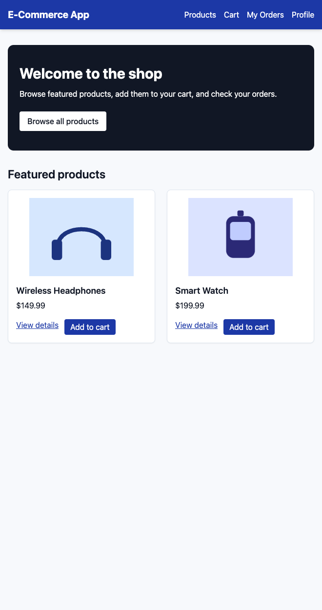

# React Shopping App

## Project Description

A small shopping application built with React and TypeScript. Visitors can browse a product catalog, view product details, add items to a cart, edit a demonstration profile, and review sample orders.

The project connects page navigation, shared application state, API requests, and automated tests in one frontend. It was developed from the supplied Atlas School Week 5 starter project.



## Usage / How It Works

1. Open the home page and browse the featured products.
2. Select **Products** to view the full catalog.
3. Open a product or use its add button to place it in the cart. Adding the same product again increases its quantity.
4. Open **Cart** to see quantities, line totals, and the overall total. Removing a product removes that entire cart line.
5. Open **Profile** to edit the sample name and email or add an address.
6. Open **My Orders** to review sample orders.

React Router switches between pages. React Query fetches and caches products from `/api/products`. Zustand holds the cart and profile state.

The product endpoint is supplied by a custom Vite plugin in development and local preview. It returns three sample products from `src/data/products.ts`.

## Installation

You need Git, Node.js, and npm. Use Node.js 22 or a newer compatible version.

```bash
git clone https://github.com/Mike-CX83/week5_assignment.git
cd week5_assignment/code/start/ecommerce-app
npm ci
npm run dev
```

Open the address printed by Vite, normally `http://localhost:5173`.

The application is inside `code/start/ecommerce-app`, so run npm commands from that folder.

## Tech Stack

* React 18 and TypeScript.
* Vite for development and builds.
* React Router for page navigation.
* Zustand for cart and profile state.
* TanStack React Query for product requests and caching.
* Tailwind CSS for styling.
* Vitest, Testing Library, and Mock Service Worker for testing.

## Build and Test

Run these commands from the application folder:

```bash
npm test
npm run build
npm run preview
```

`npm test` runs the test suite once. `npm run build` checks TypeScript and creates the production bundle. `npm run preview` serves the build locally, including the demonstration product endpoint.

Additional commands:

* `npm run test:watch`: rerun tests while editing.
* `npm run test:coverage`: generate coverage reports.
* `npm run lint`: run ESLint.

The repository includes tests for stores, navigation, product loading, cart interactions, profile changes, and order display. Mock Service Worker supplies API responses during tests.

## Current Limitations

This is a frontend demonstration. There is no login, checkout, payment processing, or persistent database. Orders are sample records. Cart and profile changes reset when the page reloads.

Uploading only the built files to a static host does not provide `/api/products`. A deployment needs an equivalent API endpoint or a change to how product data is loaded.

## Project Organization

* `code/start/ecommerce-app/src/pages/`: application pages.
* `code/start/ecommerce-app/src/components/`: shared interface elements.
* `code/start/ecommerce-app/src/stores/`: cart and user state.
* `code/start/ecommerce-app/src/api/`: product requests.
* `code/start/ecommerce-app/src/mocks/`: test API handlers.
* `code/start/ecommerce-app/screenshots/`: interface and test screenshots.

[View additional screenshots](code/start/ecommerce-app/screenshots/)  
[Original assignment brief](ASSIGNMENT.md)  
[Application documentation](code/start/ecommerce-app/README.md)

## Design Decisions

Cart and profile state are separate from product fetching. This keeps user interactions in Zustand while React Query manages remote data. Testing the stores independently makes it easier to check state changes without rendering the entire application.

## Author

**Mike Hankins**  
Atlas School software engineering student.

[GitHub profile](https://github.com/Mike-CX83)

The project builds on the course starter application and requirements.
